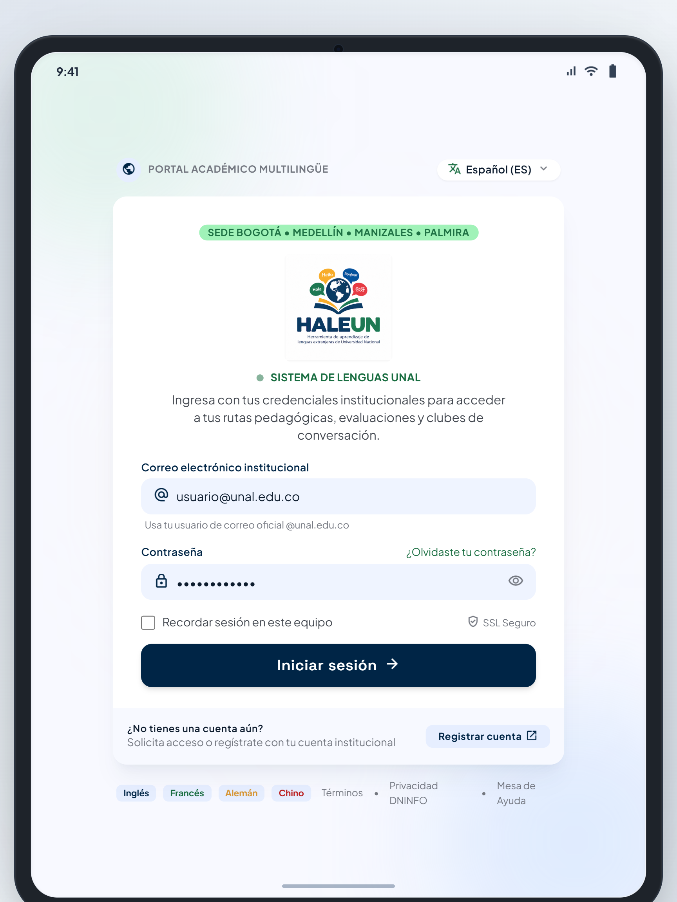
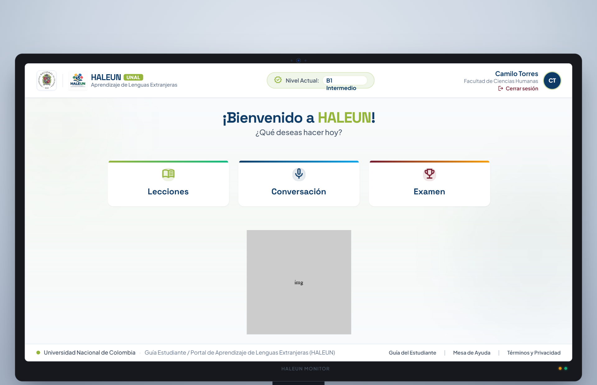
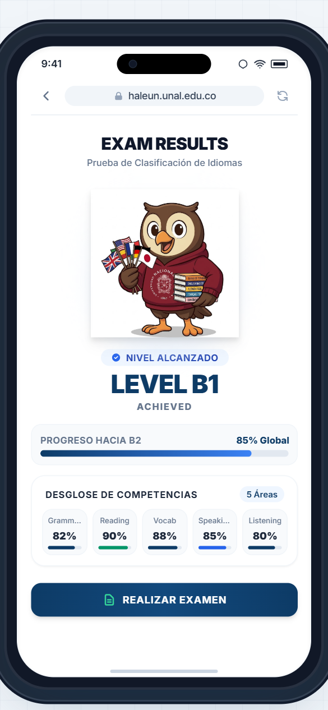
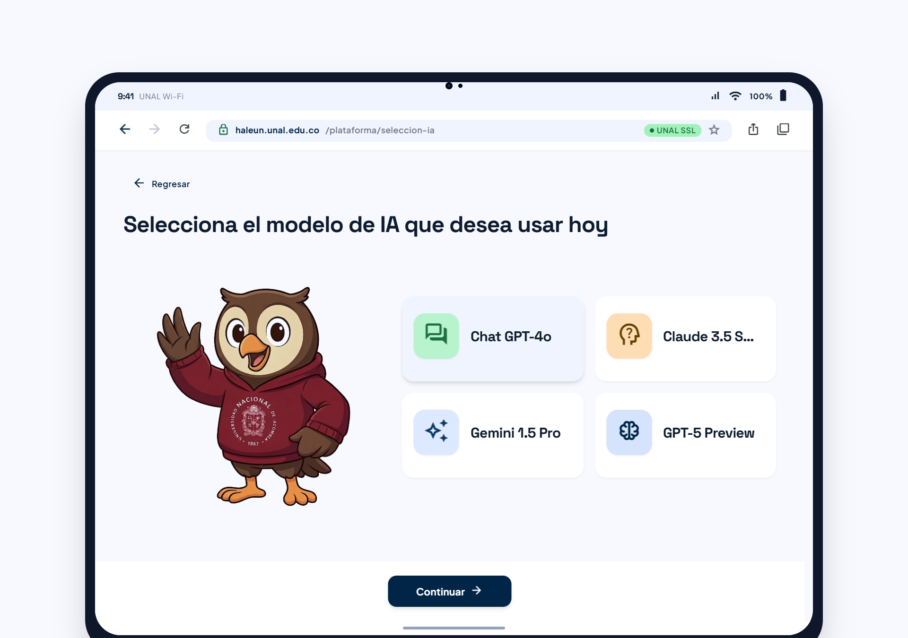
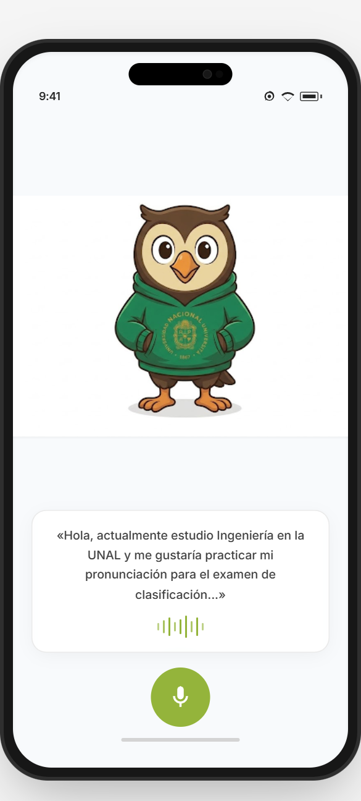
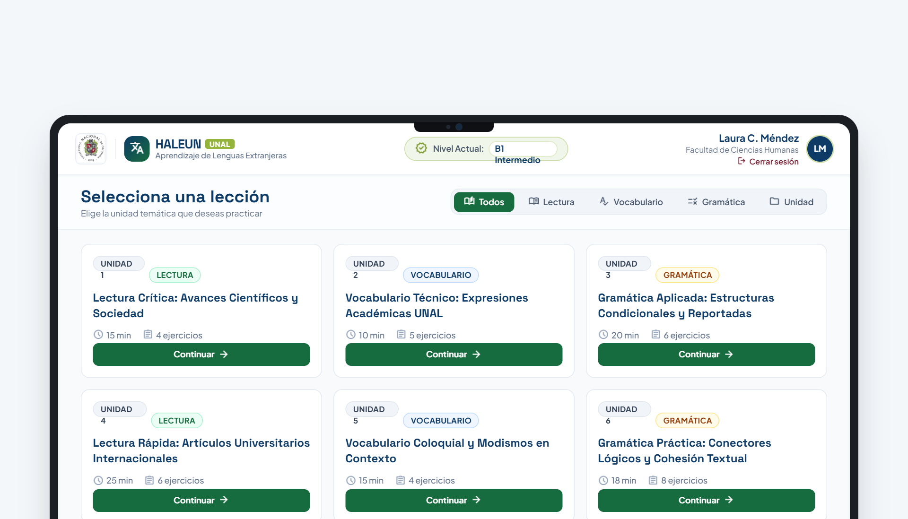

# 🎨 Galería de Mockups del Proyecto

Bienvenido a la documentación visual de la interfaz del proyecto. En este espacio se presentan los **6 mockups** representativos del diseño, flujo y experiencia de usuario (UX/UI).

---

## 📌 Descripción General

Este conjunto de maquetas visuales (mockups) muestra la estructura y estética general de la aplicación en sus diferentes pantallas y secciones clave:

1. **Registro e Inicio de Sesión**
2. **Menu Principal HALEUN**
3. **Pasarela de modelos disponibles**
4. **Practica Libre**
5. **Lecciones de practica**
6. **Examenes**

---

## 🖼️ Visualización de Mockups

A continuación se presentan las capturas de las 6 pantallas principales donde se realizaron con frames de dispositivos diferentes ya que es una app web 

| 1. Registro e Inicio de Sesión | 2. Menu Principal HALEUN |
| :---: | :---: |
|  |  |

| 3. Examenes | 4. Pasarela de modelos disponibles|
| :---: | :---: |
|  |  |

| 5. Practica Libre | 6. Lecciones de practica |
| :---: | :---: |
|  |  |

---

